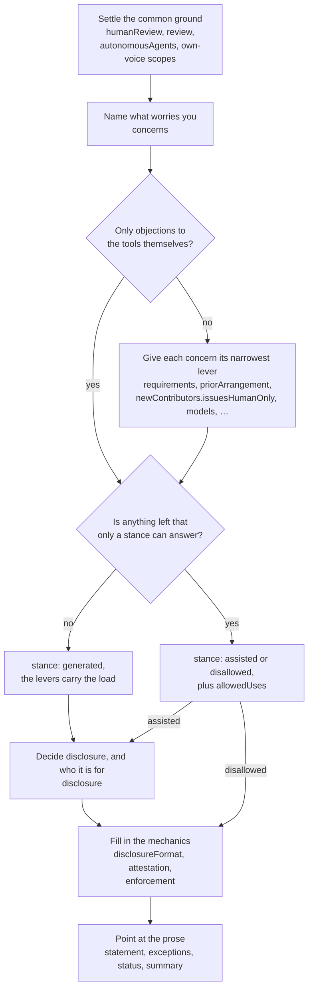

# Writing an `ai-policy.yml`

Most projects do not need to design a policy from scratch. If you already know where you stand, **take a preset and skip the rest of this guide**. The decision tree below is for projects that are still working it out.

## If you already know where you stand

Copy the matching file from [`examples/`](./examples/) as `ai-policy.yml` and, where [ai-policy.dev](https://ai-policy.dev/) has one, put the preset's `AI_POLICY.md` beside it:

| Where you stand | Preset |
|---|---|
| No AI at all, not even for translation or finding bugs | [AI Disallowed](./examples/ai-disallowed.yml) |
| Nothing AI-produced is contributed, but AI may help people understand and debug | [Research Only](./examples/research-only.yml) (structured file only; no prose preset yet) |
| Tools are private, the submission must be entirely the contributor's, no AI notes | [Human Responsible](./examples/human-responsible.yml) |
| Any tools, but every contribution needs a human who can license it | [Human Copyright](./examples/human-copyright.yml) |
| AI may write code, but every comment, issue and description is the contributor's own | [Human Voice](./examples/human-voice.yml) |
| AI welcome, as long as its use is disclosed | [AI Disclosed](./examples/ai-disclosed.yml) |
| Any tools, including agents, nothing to declare | [AI Allowed](./examples/ai-allowed.yml) |
| AI needs no rule of its own; the ordinary contribution rules cover it | [Neutral](./examples/neutral.yml) (point `statement` at your contribution guide) |

Each file ends with a **Not addressed by this preset** section: the questions the preset leaves open, as commented-out lines with their possible values. It is the quickest way to see what else your project might want to settle. Uncomment a line to decide it, list its name in `undecided` if you discussed it and could not agree (keeping a value there sets the rule meanwhile), or delete the whole section; the preset is complete without it. For a hard no, the section is short, and you can usually delete it and be done.

## Working it out

"Should we allow AI?" is the question most projects start with, and the worst place to start: argued in the abstract it goes in circles, because it bundles a dozen smaller questions that people answer differently for different reasons. The order below unbundles it:

- **Settle the common ground first.** Some questions nearly every published policy answers the same way. Confirming them takes minutes and removes them from the argument.
- **Name the concerns before choosing rules.** What actually worries your project decides which rules are worth having. The [coverage survey](./coverage.md#specificity-against-the-chaoss-domain-taxonomy) found motivations, environmental impact among them, that shaped several projects' reasoning and became a rule in none.
- **Give each concern its narrowest lever.** Most concerns have a targeted field that answers them without restricting anything else.
- **Argue the stance last**, over whatever the levers could not reach. By then the question is smaller and more concrete than the one you started with.

**No step has to block you.** Wherever your project cannot agree yet, list the field in `undecided` and move on. Then decide what applies meanwhile, which is usually far easier than the question itself: give the field a value and it is the interim rule (`stance: generated` for *go ahead while we decide*, `stance: disallowed` for *not until we have*), or leave it without one and consumers never read it as permission. The file stays honest: it publishes what you have settled without inventing the rest or letting silence pass for a decision, and the open questions stay visible for the next discussion. Even `defaults.stance` can be listed there, with `status: under-discussion`.

Any step can end in `undecided`, with or without an interim value. A valid file needs only a default `stance`, declared or undecided, or `summary: neutral`; everything else is optional. Stop wherever the rest of your policy is better said in prose.

### Settle the common ground

Where published policies address these, they mostly agree; the [coverage survey](./coverage.md) shows how widely. Confirm each and move on. If your project genuinely disagrees on one, that is worth knowing early: carry it forward as a concern rather than settling it here.

- **Is the contributor involved in the change?** `humanReview: required` means the submitter has read, understood and tested it, whatever tools they used. Most policies that say anything about AI set this.
- **Does the contributor answer for it?** `accountability: contributor` means the person who submits answers for all of it, AI-produced parts included. Many policies imply this without saying it; say it, because an agent reading your file cannot infer it.
- **Does a person make the merge decision?** `review.humanDecision: required`. Few policies state it, because few imagine otherwise; write it down anyway, since it is the half of accountability an agent reading your file cannot infer. Whether AI may *help* a reviewer is a separate switch, `review.aiAssist`.
- **May an agent submit on its own?** `autonomousAgents.allowed` says whether a non-human may open an issue or pull request without a person writing and posting each action. Where policies say, most say no, including many that accept generated code from people. If some actors may, such as maintainers or an approved bot, record them in `actorExceptions` instead of loosening the default.
- **Must communication be in the contributor's own words?** The most common per-scope rule in the corpus: `assertions[]` with `stance: disallowed` on `comments`, `issue-descriptions` and `pull-request-descriptions`, usually with `allowedUses: [translation, spelling-grammar]` so non-native speakers can still polish their text. Add `commit-messages` if they count as communication in your project.
- **Is there already a sign-off?** If you use a DCO or CLA, `signoff` records it; an agent can never provide one.

### Name what worries you

Before deciding any rule, list why your project wants a policy at all, as `concerns.values`: `code-quality`, `security`, `ip-provenance`, `licensing-ethics`, `data-consent`, `labor-ethics`, `skill-preservation`, `environmental`, `oss-sustainability`. Say them in your own words in `concerns.notes` as well, and there above all when a concern of yours is not on the list: that is how the list grows.

This is the step that makes the rest efficient. Two people arguing over whether to allow generated code are often arguing about different things, one about review load and the other about licensing, and no single answer on the stance satisfies both. Named concerns can be answered one at a time. They also go on the record: `concerns` changes nothing a consumer does, but it shows anyone aggregating policies what moves projects, which prose rationale does not.

### Give each concern its narrowest lever

Most concerns have a field that answers them directly, without restricting anything else. Work through your concerns and set the lever for each. If every concern you named is an objection to the tools themselves (the last row), skip this step and go straight to the stance:

| Concern | Narrowest levers |
|---|---|
| `code-quality` | `requirements` gates (`tests-pass`, `new-tests-required`, `ci-green`, `type-check`); `humanReview` already set |
| `oss-sustainability` (review load, slop volume) | `priorArrangement` (for example `ai-generated-prs` only against an `accepted-issue`); `newContributors.stance`, as transformers and trl use for first-time contributors; `requirements: [reproduced]`; `enforcement: [denylist]` |
| `security` | an `assertions[]` entry for `security-reports` with `requirements: [reproduced]`; `no-generated-in-security-paths`; `no-sensitive-data-to-3p` |
| `skill-preservation` | `newContributors` (a stricter stance until the first merged contribution, human-only newcomer tickets); the own-voice scopes above |
| `ip-provenance` | `requirements: [provenance-attested]`; `disclosure: required`; `models.policy.openness.trainingData` |
| `licensing-ethics`, `data-consent` | `models.policy.openness`, a floor on which models may be used at all |
| a concern stated only in `notes`, such as models carrying retired terminology forward, or a community losing the shaping of its own language | often the own-voice scopes, a stricter `docs` scope, or a terminology guide at `guardrailsRef`; a check that applies to every contribution however it was written belongs in the ordinary contribution guide rather than in `requirements` |
| `labor-ethics`, `environmental` | none: these are objections to the tools themselves, which only the stance can express |

The last row is the honest limit. Some concerns are about the tools rather than about how they are used, and no gate or pre-arrangement answers them. That is not a weakness in them: it is exactly what the stance is for.

### Is anything left that only a stance can answer?

Now decide `defaults.stance`, over what the levers did not reach:

- **`generated`:** AI may produce the substance of a contribution, subject to everything above. If every concern found a lever, this is usually where a project lands, and the levers carry the load.
- **`assisted`:** AI may help, but only menially: completion, find-and-replace, mechanical refactoring. The substance is the contributor's.
- **`disallowed`:** nothing produced by AI may be submitted.

The stance is about permission, not preference: what a contribution may contain, not what the project would like. Different content types may need different answers; add an `assertions[]` entry for each `scope` that departs from the default, setting only the fields that change. Scopes are `code`, `docs`, `tests`, `comments`, `issue-descriptions`, `pull-request-descriptions`, `commit-messages`, `translations`, `media` and `security-reports`.

If the stance is `disallowed`, you can skip disclosure entirely: there is nothing AI-produced to disclose. If the stance is `assisted` or `disallowed`, say what stays permitted, or the policy reads as blanket hostility. `allowedUses` lists AI uses whose output is *not* contributed: `research`, `comprehension`, `bug-triage`, `debugging`, `accessibility`, `spelling-grammar`, `translation`. A use you leave out is not exempt; it falls under the stance like everything else. Assistance whose output does end up in the contribution is `stance: assisted`, not an allowed use.

### Decide disclosure, and who it is for

Disclosure is contested in its own right, and the useful question is not whether but *for whom*. A note can help a reviewer calibrate, track provenance for licensing, serve downstream citation, or simply sort contributors into categories, and the answer decides the value:

- **`prohibited`:** notes about AI tools must be left out, because the project judges the submission and not the process. Agents tend to add such notes by default, so this needs saying.
- **`none`:** not asked for.
- **`encouraged`:** welcome, nothing gated on it; enough for reviewer calibration.
- **`required`:** a contribution without it may be refused; what provenance tracking needs.

Disclosure can differ by scope like everything else; curl requires it for security reports and only encourages it for translations.

### Fill in the mechanics

These follow from decisions already made, and each can be skipped when the decision it depends on makes it moot:

- **`disclosureFormat`:** skip it unless you encourage or require disclosure; if you do, it says where it goes (`method`, one or more of `free-text`, `commit-trailer`, `pr-template`, `quote-block`) and which trailer to use; `trailers` can distinguish degrees, such as `Assisted-by:` and `Generated-by:`. `content` says what a disclosure must state: the `tool`, the `model`, the `extent` of AI's part, or what it was used for (`usage`).
- **`autonomousAgents.attestation`:** skip it unless agents are allowed somewhere; if they are, it says how they identify themselves (`bot-account`, `signed-commits`, `integration-manifest`).
- **`enforcement`:** how the policy is applied (`maintainer-review`, `ci-check`, `denylist`, `none`), with any consequence in a sentence.
- **`review.notes`:** rules about review bots, such as separate accounts or non-blocking comments.

### Point at the prose and finish

- **`statement`:** where your human-readable policy lives, usually `AI_POLICY.md` or a section of `CONTRIBUTING.md`. This is the authoritative text; the file summarises it.
- **`guardrailsRef`:** where a contributor's practical checklist lives, if you have one separate from the policy.
- **`exceptions: true`:** set it whenever the prose says something the fields do not. Any nuance you found no field for belongs here and in `notes`, not in a squeezed enum.
- **`status`:** `adopted`, `draft` or `under-discussion`.
- **`undecided`:** every question you could not settle yet; keep a value on any that has a rule in force meanwhile.
- **`summary`:** optional, and derived from the stance rather than chosen: `disallowed` for a `disallowed` stance, `restrictive` for `assisted`, and for `generated` either `permissive` or, once you add an AI-specific condition (a scope held below `generated`, disclosure `required` or `prohibited`, a `requirements` gate, or a prior-arrangement gate), `mixed`. A project with no AI-specific rule at all uses `neutral` instead of a stance. If you set it, the schema checks that it matches.

Then validate the file against [`ai-policy.schema.yaml`](./ai-policy.schema.yaml), and point your `AGENTS.md` and `CONTRIBUTING.md` at it so agents and people find it where they already look.
