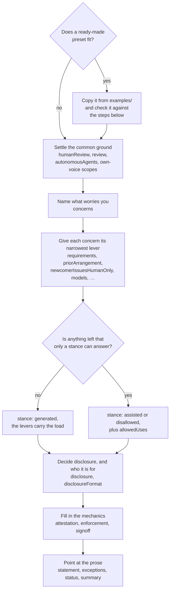

# Writing an `ai-policy.yml`

A walk through the format as a series of decisions. The [schema](./ai-policy.schema.yaml) has the exact values and the [example](./ai-policy.example.yml) shows every field in use; this guide is about the order in which to decide them.

"Should we allow AI?" is the question most projects start with, and the worst place to start: argued in the abstract it goes in circles, because it bundles a dozen smaller questions that people answer differently for different reasons. The order below unbundles it:

- **Settle the common ground first.** Some questions nearly every published policy answers the same way. Confirming them takes minutes and removes them from the argument.
- **Name the concerns before choosing rules.** What actually worries your project decides which rules are worth having. The [coverage survey](./coverage.md#specificity-against-the-chaoss-domain-taxonomy) found motivations, environmental impact among them, that shaped several projects' reasoning and became a rule in none.
- **Give each concern its narrowest lever.** Most concerns have a targeted field that answers them without restricting anything else.
- **Argue the stance last**, over whatever the levers could not reach. By then the question is smaller and more concrete than the one you started with.

A valid file needs only a `summary` and a default `stance`; everything else is optional. Stop wherever the rest of your policy is better said in prose.

## Start from a preset

If one of the [ai-policy.dev](https://ai-policy.dev/) policies already says what you want, copy its file from [`examples/`](./examples/) as `ai-policy.yml` and put the matching `AI_POLICY.md` beside it:

- **AI Allowed:** any tooling, including agents, no disclosure asked. [`ai-allowed.yml`](./examples/ai-allowed.yml)
- **Human Voice:** AI may write code, but every comment, issue and description is the contributor's own. [`human-voice.yml`](./examples/human-voice.yml)
- **Human Responsible:** tooling is private, the submission must be entirely the contributor's, no AI notes, no agents. [`human-responsible.yml`](./examples/human-responsible.yml)
- **AI Disallowed:** no AI at all. [`ai-disallowed.yml`](./examples/ai-disallowed.yml)

A preset is a starting point, not a finished answer. Walking through the steps below with one in hand is quick, and shows where your project differs from it.

## Settle the common ground

Where published policies address these, they mostly agree; the [coverage survey](./coverage.md) shows how widely. Confirm each and move on. If your project genuinely disagrees on one, that is worth knowing early: carry it forward as a concern rather than settling it here.

- **Does the contributor answer for the change?** `humanReview: required` means the submitter has read, understood and tested it, whatever tools they used. Almost every policy sets this.
- **Does a person make the merge decision?** `review.humanDecision: required`. Few policies state it, because few imagine otherwise; write it down anyway, since it is the half of accountability an agent reading your file cannot infer. Whether AI may *help* a reviewer is a separate switch, `review.aiAssist`.
- **May an agent submit on its own?** `autonomousAgents.allowed` says whether a non-human may open an issue or pull request without a person writing and posting each action. Where policies say, most say no, including many that accept generated code from people. If some actors may, such as maintainers or an approved bot, record them in `actorExceptions` instead of loosening the default.
- **Must communication be in the contributor's own words?** The most common per-scope rule in the corpus: `assertions[]` with `stance: disallowed` on `comments`, `issue-descriptions` and `pull-request-descriptions`, usually with `allowedUses: [translation, spelling-grammar]` so non-native speakers can still polish their text. Add `commit-messages` if they count as communication in your project.
- **Is there already a sign-off?** If you use a DCO or CLA, `signoff` records it; an agent can never provide one.

## Name what worries you

Before deciding any rule, list why your project wants a policy at all, as `concerns`: `code-quality`, `security`, `ip-provenance`, `licensing-ethics`, `data-consent`, `labor-ethics`, `skill-preservation`, `environmental`, `oss-sustainability`.

This is the step that makes the rest efficient. Two people arguing over whether to allow generated code are often arguing about different things, one about review load and the other about licensing, and no single answer on the stance satisfies both. Named concerns can be answered one at a time. They also go on the record: `concerns` changes nothing a consumer does, but it shows anyone aggregating policies what moves projects, which prose rationale does not.

## Give each concern its narrowest lever

Most concerns have a field that answers them directly, without restricting anything else. Work through your concerns and set the lever for each:

| Concern | Narrowest levers |
|---|---|
| `code-quality` | `requirements` gates (`tests-pass`, `new-tests-required`, `ci-green`, `type-check`); `humanReview` already set |
| `oss-sustainability` (review load, slop volume) | `priorArrangement` (for example `ai-generated-prs` only against an `accepted-issue`); `requirements: [reproduced]`; `enforcement: [denylist]` |
| `security` | an `assertions[]` entry for `security-reports` with `requirements: [reproduced]`; `no-generated-in-security-paths`; `no-sensitive-data-to-3p` |
| `skill-preservation` | `newcomerIssuesHumanOnly: true`; the own-voice scopes above |
| `ip-provenance` | `requirements: [provenance-attested]`; `disclosure: required`; `models.policy.openness.trainingData` |
| `licensing-ethics`, `data-consent` | `models.policy.openness`, a floor on which models may be used at all |
| `labor-ethics`, `environmental` | none: these are objections to the tools themselves, which only the stance can express |

The last row is the honest limit. Some concerns are about the tools rather than about how they are used, and no gate or pre-arrangement answers them. That is not a weakness in them: it is exactly what the stance is for.

## Is anything left that only a stance can answer?

Now decide `defaults.stance`, over what the levers did not reach:

- **`generated`:** AI may produce the substance of a contribution, subject to everything above. If every concern found a lever, this is usually where a project lands, and the levers carry the load.
- **`assisted`:** AI may help, but only menially: completion, find-and-replace, mechanical refactoring. The substance is the contributor's.
- **`disallowed`:** nothing produced by AI may be submitted.

The stance is about permission, not preference: what a contribution may contain, not what the project would like. Different content types may need different answers; add an `assertions[]` entry for each `scope` that departs from the default, setting only the fields that change. Scopes are `code`, `docs`, `tests`, `comments`, `issue-descriptions`, `pull-request-descriptions`, `commit-messages`, `translations`, `media` and `security-reports`.

If the stance is `assisted` or `disallowed`, say what stays permitted, or the policy reads as blanket hostility. `allowedUses` lists AI uses whose output is *not* contributed: `research`, `comprehension`, `bug-triage`, `debugging`, `accessibility`, `spelling-grammar`, `translation`. A use you leave out is not exempt; it falls under the stance like everything else. Assistance whose output does end up in the contribution is `stance: assisted`, not an allowed use.

## Decide disclosure, and who it is for

Disclosure is contested in its own right, and the useful question is not whether but *for whom*. A note can help a reviewer calibrate, track provenance for licensing, serve downstream citation, or simply sort contributors into categories, and the answer decides the value:

- **`prohibited`:** notes about AI tools must be left out, because the project judges the submission and not the process. Agents tend to add such notes by default, so this needs saying.
- **`none`:** not asked for.
- **`encouraged`:** welcome, nothing gated on it; enough for reviewer calibration.
- **`required`:** a contribution without it may be refused; what provenance tracking needs.

Disclosure can differ by scope like everything else; curl requires it for security reports and only encourages it for translations.

## Fill in the mechanics

These follow from decisions already made:

- **`disclosureFormat`:** if you encourage or require disclosure, where it goes (`method`: `free-text`, `commit-trailer`, `pr-template`, `quote-block`) and which trailer to use; `trailers` can distinguish degrees, such as `Assisted-by:` and `Generated-by:`. What a disclosure must *name*, the model or the extent, goes in `notes`.
- **`autonomousAgents.attestation`:** if agents are allowed anywhere, how they identify themselves (`bot-account`, `signed-commits`, `integration-manifest`).
- **`enforcement`:** how the policy is applied (`maintainer-review`, `ci-check`, `denylist`, `none`), with any consequence in a sentence.
- **`review.notes`:** rules about review bots, such as separate accounts or non-blocking comments.

## Point at the prose and finish

- **`statement`:** where your human-readable policy lives, usually `AI_POLICY.md` or a section of `CONTRIBUTING.md`. This is the authoritative text; the file summarises it.
- **`guardrailsRef`:** where a contributor's practical checklist lives, if you have one separate from the policy.
- **`exceptions: true`:** set it whenever the prose says something the fields do not. Any nuance you found no field for belongs here and in `notes`, not in a squeezed enum.
- **`status`:** `adopted`, `draft` or `under-discussion`.
- **`summary`:** your one-word reading of the whole, for catalogues and badges: `permissive`, `mixed`, `restrictive` or `disallowed`. Set it last, once the rest is settled.

Then validate the file against [`ai-policy.schema.yaml`](./ai-policy.schema.yaml), and point your `AGENTS.md` and `CONTRIBUTING.md` at it so agents and people find it where they already look.
